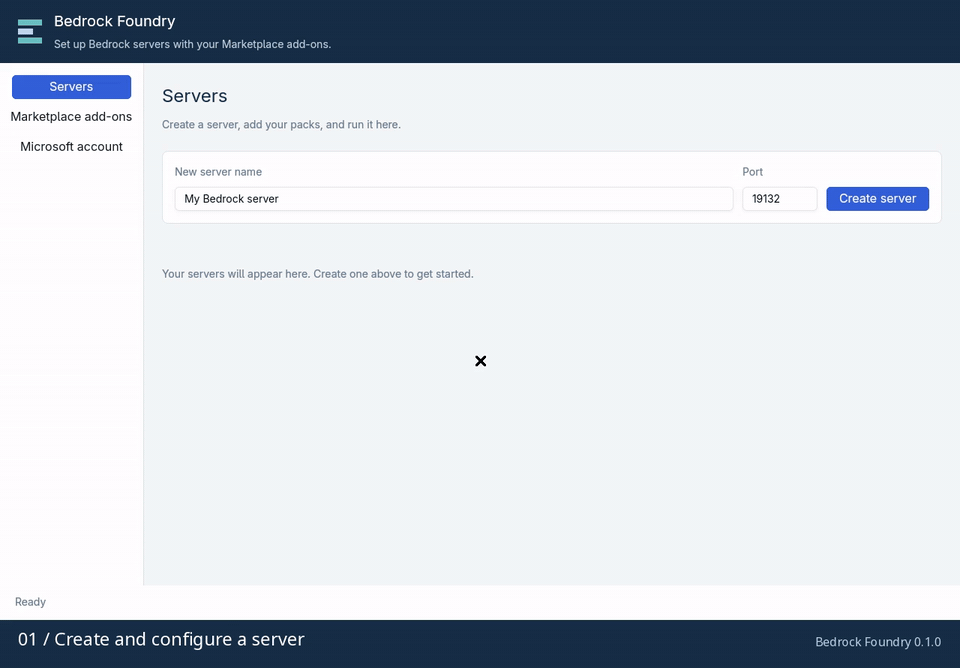
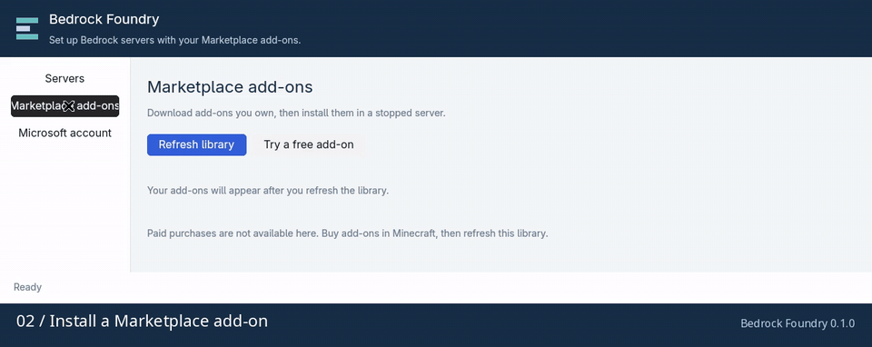
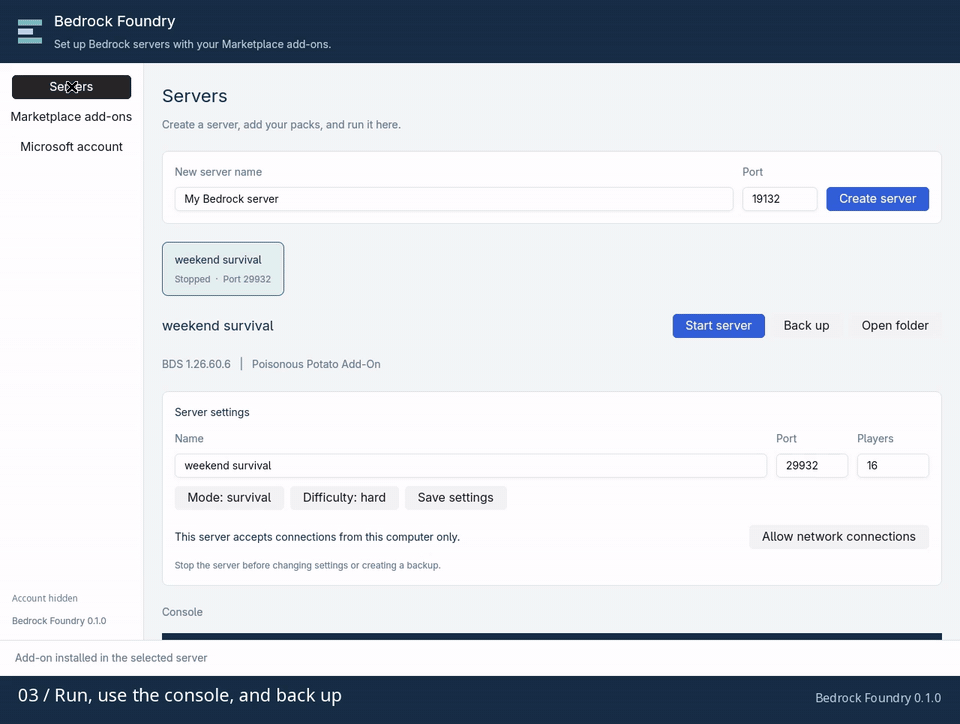

# Bedrock Foundry

Set up Bedrock servers with your Marketplace add-ons.

Bedrock Foundry is a Rust desktop application built with [GPUI](https://gpui.rs/).
Connect your Microsoft account, download add-ons that you own, and install them
in a Bedrock Dedicated Server (BDS) instance. Start and stop servers, send console
commands, change settings, and create backups from the same window. Browse and
search Marketplace listings, check your Minecoin balance, and buy standalone
add-ons after reviewing the price.

This is an early release. Local hosting targets Windows and Linux. See the
[compatibility notes](docs/compatibility.md) for tested behavior and current limits.

## Demos

These clips show the original v0.1.0 release, before the desktop redesign.
They use a separate demo server. Sign-in and BDS import
happen before the add-on demo. Account details are hidden.

### Create and configure a server

https://github.com/user-attachments/assets/a2a869f9-dbe3-4c64-bc3e-12f08dfbf5b5

[Download MP4 (9 seconds)](docs/media/create-server.mp4)

<details>
<summary>GIF preview</summary>



</details>

### Install a Marketplace add-on

https://github.com/user-attachments/assets/533b336a-da15-4f9d-b8d5-a43ffa9da5b9

[Download MP4 (8 seconds)](docs/media/install-addon.mp4)

<details>
<summary>GIF preview</summary>



</details>

### Run, use the console, and back up

https://github.com/user-attachments/assets/47a2778c-5fbc-4e92-b48a-a22ab398ef7b

[Download MP4 (13 seconds)](docs/media/manage-server.mp4)

<details>
<summary>GIF preview</summary>



</details>

## Run the app

Build from `main` for the Marketplace browser, Minecoin purchases, and redesigned
desktop. The downloadable v0.1.0 release uses the original interface shown in the demos.

Download the Linux or Windows archive from [Releases](https://github.com/StackAnvil/BedrockFoundry/releases/latest).
Extract it and run `bedrock-foundry` on Linux or `bedrock-foundry.exe` on Windows.
The [release guide](docs/releases.md#verify-a-download) explains checksum verification.
Linux archives target Ubuntu 24.04 or a compatible system with a Vulkan driver.

To build from source, install the native dependencies in the [build guide](docs/development.md), then run:

```sh
git clone https://github.com/StackAnvil/BedrockFoundry.git
cd BedrockFoundry
cargo run --locked
```

The pinned Rust toolchain is installed through rustup. For a release build, run
`cargo build --locked --release`.

## Set up a server

1. Open **Microsoft account** and select **Sign in with Microsoft**.
2. Complete sign-in on the Microsoft page with the displayed code.
3. Open **My add-ons** and select **Refresh**.
4. Download an add-on that you own. **Try a free add-on** offers a free sample.
5. Select **New server**, enter a name and port, and select **Create server**.
6. Select **Download and install**. You can also import an official BDS ZIP.
7. Open the server's **Add-ons** tab and install the downloaded add-on.
8. Select **Start server**. The **Console**, **Settings**, and **Backups** tabs manage that server.

## Browse and buy add-ons

Open **Marketplace** to browse listings with thumbnails, descriptions, and prices.
It opens with **Add-ons only** selected. Select **Everything** to browse all product types.
Search by name or topic and select **Next** for more results.
Results show the newest listings first.
Worlds, skin packs, and character creator products are viewable. Purchases and
BDS installation are available for standalone add-ons.

Select an add-on, then **Buy…** to review its current price and your Minecoin balance.
Confirm with **Buy for N Minecoins** to spend that amount from the connected account.
The app checks the offer and balance again before submitting. Add Minecoins through
Minecraft if your balance is too low. Foundry does not buy currency with real money.

If a purchase has an unknown outcome, refresh **My add-ons** and check it in Minecraft.
Foundry records the attempt and blocks another purchase of that offer until ownership
is confirmed. It does not automatically retry a purchase. Offers with unverified or
conflicting prices must be bought in Minecraft.

BDS downloads come from Mojang. Review the [Minecraft EULA](https://www.minecraft.net/eula)
before downloading or running the server software. Foundry does not include a server binary.

Account credentials stay in the OS credential store. Downloads, servers, and
backups stay in the application data directory. The [CLI reference](docs/cli.md)
describes commands for terminal use and separate data directories.

## Connect other players

New instances bind to this computer only. Stop the server and enable network
access in its **Settings** tab to accept connections from other computers.
[The hosting guide](docs/hosting.md) explains NetherNet ports, router forwarding,
and connections behind carrier-grade NAT.

## Contributing

Read [CONTRIBUTING.md](CONTRIBUTING.md) for checks, issue reports, and pull requests.
The [release guide](docs/releases.md) covers version tags and automated publishing.

## License

Bedrock Foundry source code is [MIT licensed](LICENSE). Dependencies retain their
own licenses; see [third-party notices](THIRD_PARTY_NOTICES.md). Minecraft server
software and Marketplace content retain their original licenses and are not
redistributed by this project.
